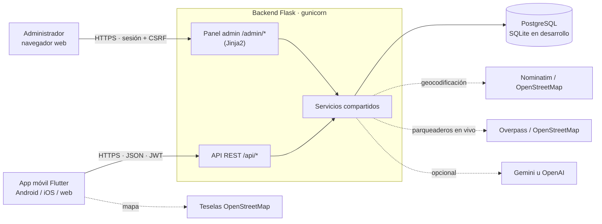
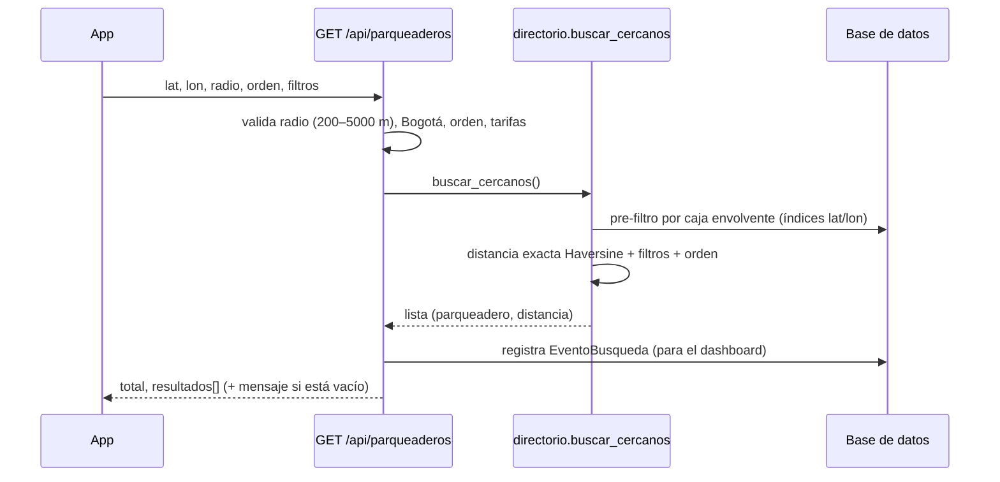
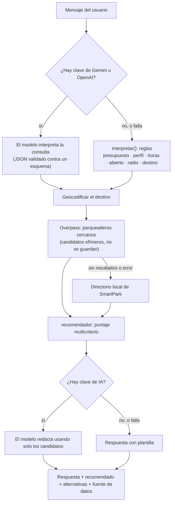

# Arquitectura

## Visión general



- **API REST** (`/api`): la consume la app móvil. Autenticación con JWT.
- **Panel de administración** (`/admin`): sitio web renderizado en el servidor, con sesión por cookie y protección CSRF.
- Ambos viven en el **mismo servicio Flask** y comparten modelos, validaciones y lógica del directorio.
- La base de datos es **SQLite** en desarrollo y **PostgreSQL** en producción (se elige con `DATABASE_URL`).

## Estructura del backend

```
backend/
├── wsgi.py                  punto de entrada (gunicorn: wsgi:app)
├── Dockerfile               imagen sobre Ubuntu 24.04 + Python 3.12
├── docker/entrypoint.sh     espera la BD, ejecuta flask init-db, siembra/crea admin y lanza gunicorn
├── app/
│   ├── __init__.py          create_app(): configuración, CORS, blueprints, cabeceras, migraciones ligeras, CLI
│   ├── config.py            Config / TestConfig / ProductionConfig (variables de entorno)
│   ├── extensions.py        instancia de SQLAlchemy
│   ├── models.py            tablas del modelo físico + Notificacion + EventoBusqueda
│   ├── api/                 rutas JSON: auth, parqueaderos, resenas, chat, recomendaciones
│   ├── admin/               rutas del panel web (dashboard, directorio, reportes, auditoría)
│   ├── services/
│   │   ├── auth.py          emisión y validación de JWT, decoradores token_requerido / token_opcional
│   │   ├── ratelimit.py     bloqueo de login tras demasiados fallos
│   │   ├── errors.py        ApiError y manejadores: toda falla sale como JSON con código y mensaje
│   │   ├── geo.py           distancia Haversine, caja envolvente, límites de Bogotá
│   │   ├── geocoding.py     destino → coordenadas (catálogo local + Nominatim)
│   │   ├── openstreetmap.py consulta de parqueaderos cercanos en Overpass (candidatos efímeros)
│   │   ├── recomendador.py  puntaje multicriterio (gasolina, rodamiento, tiempo, distancia, seguridad, precio)
│   │   ├── chat.py          asistente: interpretar → buscar (OSM o directorio) → puntuar → redactar
│   │   ├── directorio.py    búsqueda por proximidad, tarifas con historial, auditoría
│   │   └── validacion.py    reglas de validación compartidas por API y panel
│   ├── templates/admin/     vistas Jinja2 del panel
│   └── static/              CSS y librerías locales del panel (Leaflet, Chart.js; sin CDN)
└── tests/                   186 casos con pytest (unitarios, funcionales, IA/OSM y seguridad)
```

Reglas de la separación por capas: las rutas (`api/`, `admin/`) solo reciben, validan y responden; la lógica
reutilizable vive en `services/`; los datos y sus reglas básicas (promedio de calificación, horario abierto, tarifa
vigente) viven en `models.py`.

## Estructura de la app móvil

```
mobile/lib/
├── main.dart              arranque, providers; sesión → login o home
├── config.dart            URL del API (--dart-define=API_URL) y límites de radio
├── models.dart            Usuario, Parqueadero, Resena, Destino
├── formato.dart           formato COP, distancias, "Tarifa no disponible"
├── services/api.dart      cliente REST: añade el JWT, traduce errores a ApiException; 401 → vuelve al login
├── state/sesion.dart      token persistido con shared_preferences
├── state/busqueda.dart    ubicación, destino, radio, orden, filtros y resultados (Provider)
└── screens/               login, home (navegación), mapa, lista, recomendar (IA), detalle, chat, perfil
```

Gestión de estado con **Provider**. El mapa usa `flutter_map` con teselas de OpenStreetMap (sin API key). La app también
se compila para web (`mobile/Dockerfile.web`, servida con nginx).

## Flujos principales

### Buscar parqueaderos (HU 4–9)



El pre-filtro rectangular permite usar índices de la base de datos y calcular la distancia exacta solo para pocos
candidatos, lo que mantiene la consulta en milisegundos (requisito de respuesta < 2 s).

### Calificar un parqueadero (HU 10–11)

1. La app registra la visita: `POST /api/parqueaderos/{id}/visitas`.
2. Solo con una visita previa se acepta `POST /api/parqueaderos/{id}/resenas` (si no: `403 sin_visita`).
3. Hay **una reseña por usuario y parqueadero**: volver a calificar la actualiza.
4. Al guardar se recalcula `calificacion_promedio` del parqueadero.

### Asistente de IA (RF-12)



Decisiones de diseño:

- **El parqueadero recomendado lo decide el cálculo local**, no el modelo de lenguaje: el modelo solo interpreta la
  consulta (su salida se valida contra un esquema y se descarta lo que no encaja) y redacta el texto con los candidatos
  ya puntuados. No puede inventar parqueaderos, precios ni disponibilidad.
- **Fuente de datos:** primero OpenStreetMap vía Overpass; si no responde o no hay resultados que cumplan los filtros se
  usa el directorio local, y la respuesta lo avisa (`fuente_datos`, `aviso_osm`, `aviso_respaldo`). Los candidatos de
  OSM no se guardan en la base de datos.
- **Sin inventar datos:** si OSM no reporta tarifa, se muestra "No reportado" y no se afirma que cumple un presupuesto.
- **Proveedor:** si hay `OPENAI_API_KEY` se usa OpenAI; si no, y hay `GEMINI_API_KEY`, Gemini; sin ninguna, todo el flujo
  funciona con reglas. Los errores de cuota o saturación del modelo se informan al usuario.
- El cálculo multicriterio está explicado en [modelo-ia.md](modelo-ia.md). La pantalla *Recomendar* de la app usa
  directamente `POST /api/recomendaciones`.

### Moderación de reseñas (RF-10)

Un usuario reporta una reseña → queda un `ReporteUsuario` pendiente → el administrador **advierte**, **suspende** o
**descarta** desde el panel → el usuario reportado recibe una `Notificacion` que la app muestra en su perfil. Suspender
rechaza la reseña y recalcula el promedio.

## Seguridad

| Aspecto | Implementación |
|---|---|
| Contraseñas | bcrypt (con sal), mínimo 8 caracteres |
| API | JWT HS256, expiración configurable (24 h por defecto); `401 token_expirado` / `token_invalido`; cuenta suspendida → `403` |
| Panel admin | Sesión por cookie `HttpOnly`, `SameSite=Lax`, `Secure` en producción; token CSRF en todos los POST; solo usuarios con `es_admin` activos |
| Fuerza bruta | Bloqueo `429` tras `LOGIN_MAX_INTENTOS` fallos por IP + correo en `LOGIN_VENTANA_S` segundos (en memoria por proceso) |
| Configuración | Con `FLASK_ENV=production` la app **no arranca** si `SECRET_KEY` o `JWT_SECRET` están vacías o son valores de ejemplo |
| Cabeceras | `X-Content-Type-Options`, `X-Frame-Options: DENY`, `Referrer-Policy` |
| Auditoría | Cada alta/edición/baja del directorio guarda quién, cuándo, IP y datos antes/después |
| Entrada | Validación centralizada (`validacion.py`); consultas con SQLAlchemy (parametrizadas) |

## Decisiones y limitaciones conocidas

- **SQLAlchemy + PostgreSQL** (y SQLite en desarrollo). La especificación mencionaba MongoDB en una sección; se eligió
  la opción que tiene el modelo físico definido.
- **Sin Redis**: la búsqueda responde en milisegundos con el pre-filtro por caja envolvente; los resultados de las
  pruebas de carga están en el informe de carga y estrés.
- **Migraciones ligeras**: `db.create_all()` crea tablas nuevas y `_migraciones_ligeras()` agrega columnas nuevas
  (`ALTER TABLE ... ADD COLUMN`). No cambia ni elimina columnas existentes: para eso hará falta Flask-Migrate/Alembic.
- **Límite de login en memoria**: con varios workers, el límite real es N × workers. Para un límite global, usar Redis.
- **Servicios públicos de OSM** (Nominatim y Overpass): tienen límites de uso y pueden fallar; por eso existen el
  catálogo local de lugares y el respaldo con el directorio local.
- **Pendiente del alcance**: recuperación de contraseña por correo e inicio de sesión con redes sociales.
