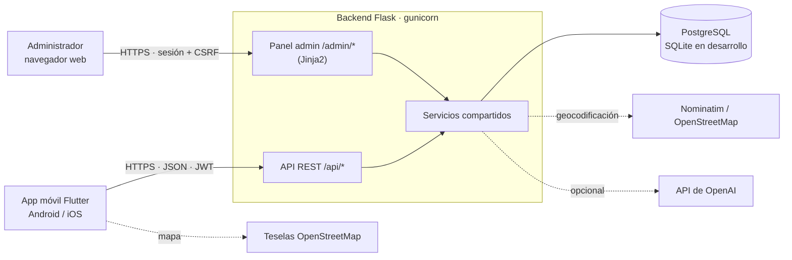
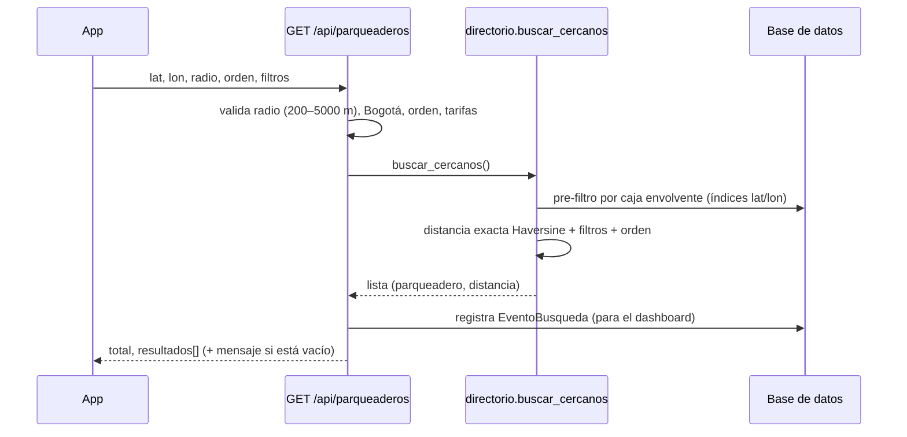
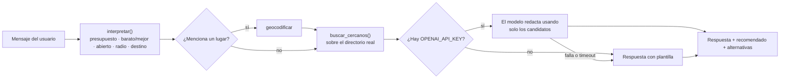

# Arquitectura

## Visión general



- **API REST** (`/api`): la consume la app móvil. Autenticación con JWT.
- **Panel de administración** (`/admin`): sitio web renderizado en el servidor, con sesión por cookie y protección CSRF.
- Ambos viven en el **mismo servicio Flask** y comparten modelos, validaciones y lógica del directorio.
- La base de datos es **SQLite** en desarrollo y **PostgreSQL** en producción (se elige con `DATABASE_URL`).

## Estructura del backend

```
backend/
├── wsgi.py                  punto de entrada (gunicorn: wsgi:app)
├── app/
│   ├── __init__.py          create_app(): configuración, CORS, blueprints, cabeceras, comandos CLI
│   ├── config.py            Config / TestConfig / ProductionConfig (variables de entorno)
│   ├── extensions.py        instancia de SQLAlchemy
│   ├── models.py            8 tablas del modelo físico + Notificacion + EventoBusqueda
│   ├── api/                 rutas JSON: auth, parqueaderos, resenas, chat
│   ├── admin/               rutas del panel web (dashboard, directorio, reportes, auditoría)
│   ├── services/
│   │   ├── auth.py          emisión y validación de JWT, decoradores token_requerido / token_opcional
│   │   ├── ratelimit.py     bloqueo de login tras demasiados fallos
│   │   ├── errors.py        ApiError y manejadores: toda falla sale como JSON con código y mensaje
│   │   ├── geo.py           distancia Haversine, caja envolvente, límites de Bogotá
│   │   ├── geocoding.py     destino → coordenadas (catálogo local + Nominatim)
│   │   ├── directorio.py    búsqueda por proximidad, tarifas con historial, auditoría
│   │   ├── validacion.py    reglas de validación compartidas por API y panel
│   │   └── chat.py          asistente: interpretar consulta → buscar → redactar
│   ├── templates/admin/     vistas Jinja2 del panel
│   └── static/              CSS y librerías locales (Leaflet, Chart.js; no dependen de CDN)
└── tests/                   37 pruebas con pytest
```

Reglas de la separación por capas: las rutas (`api/`, `admin/`) solo reciben, validan y responden; la lógica
reutilizable vive en `services/`; los datos y sus reglas básicas (promedio de calificación, horario abierto, tarifa
vigente) viven en `models.py`.

## Estructura de la app móvil

```
mobile/lib/
├── main.dart              arranque, providers; sesión → login o home
├── config.dart            URL del API (--dart-define=API_URL) y límites de radio
├── models.dart            Usuario, Parqueadero, Resena, Destino
├── services/api.dart      cliente REST: añade el JWT, traduce errores a ApiException; 401 → vuelve al login
├── state/sesion.dart      token persistido con shared_preferences
├── state/busqueda.dart    ubicación, destino, radio, orden, filtros y resultados (Provider)
└── screens/               login, home (navegación), mapa, lista, detalle, chat, perfil
```

Gestión de estado con **Provider**. El mapa usa `flutter_map` con teselas de OpenStreetMap (sin API key).

## Flujos principales

### Buscar parqueaderos (HU 4–9)



El pre-filtro rectangular permite usar índices de la base de datos y calcular la distancia exacta solo para pocos
candidatos, lo que mantiene la consulta en milisegundos (requisito de respuesta < 2 s).

### Calificar un parqueadero (HU 10–11)

1. La app registra la visita: `POST /api/parqueaderos/{id}/visitas`.
2. Solo con una visita previa se acepta `POST /api/parqueaderos/{id}/resenas` (si no: `403 sin_visita`).
3. Hay **una reseña por usuario y parqueadero**: volver a calificar la actualiza.
4. Al guardar se recalcula `calificacion_promedio` del parqueadero.

### Asistente de IA (RF-12)



Decisión de diseño: **el parqueadero recomendado siempre sale del directorio** (el primero del ranking calculado
localmente). El modelo de lenguaje solo redacta el texto con datos reales, por lo que no puede inventar parqueaderos,
precios ni disponibilidad. Si el modelo falla, se responde con la plantilla.

### Moderación de reseñas (RF-10)

Un usuario reporta una reseña → queda un `ReporteUsuario` pendiente → el administrador **advierte**, **suspende** o
**descarta** desde el panel → el usuario reportado recibe una `Notificacion` que la app muestra en su perfil. Suspender
rechaza la reseña y recalcula el promedio.

## Seguridad

| Aspecto | Implementación |
|---|---|
| Contraseñas | bcrypt (con sal), mínimo 8 caracteres |
| API | JWT HS256, expiración configurable (24 h por defecto); `401 token_expirado` / `token_invalido`; cuenta suspendida → `403` |
| Panel admin | Sesión por cookie `HttpOnly`, `SameSite=Lax`, `Secure` en producción; token CSRF en todos los POST; solo usuarios con `es_admin` activos |
| Fuerza bruta | Bloqueo `429` tras `LOGIN_MAX_INTENTOS` fallos por IP + correo en `LOGIN_VENTANA_S` segundos (en memoria por proceso) |
| Configuración | En producción la app **no arranca** sin `SECRET_KEY` |
| Cabeceras | `X-Content-Type-Options`, `X-Frame-Options: DENY`, `Referrer-Policy` |
| Auditoría | Cada alta/edición/baja del directorio guarda quién, cuándo, IP y datos antes/después |
| Entrada | Validación centralizada (`validacion.py`); consultas con SQLAlchemy (parametrizadas) |

## Decisiones y limitaciones conocidas

- **SQLAlchemy + PostgreSQL** (y SQLite en desarrollo). La especificación mencionaba MongoDB en una sección; se eligió
  la opción que tiene el modelo físico definido.
- **Sin Redis**: la búsqueda responde en milisegundos con el pre-filtro por caja envolvente; conviene medir en pruebas
  de carga antes de añadir caché.
- **Migraciones**: hoy se usa `db.create_all()`. Antes de tener datos reales en producción, adoptar Flask-Migrate/Alembic.
- **Límite de login en memoria**: con varios workers, el límite real es N × workers. Para un límite global, usar Redis.
- **Pendiente del alcance**: recuperación de contraseña por correo e inicio de sesión con redes sociales.
- La geocodificación depende de Nominatim (servicio público con límites de uso); si no responde, se usa un catálogo local
  de lugares frecuentes de Bogotá.
