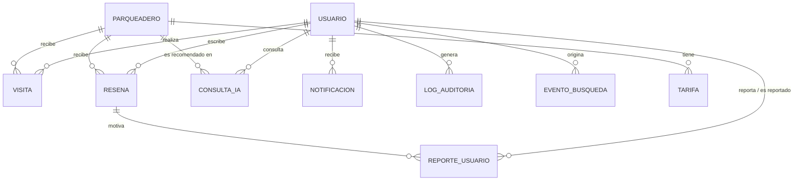

# Modelo de datos

Implementado con SQLAlchemy 2.0 en `backend/app/models.py`. Las 8 tablas físicas del documento de especificaciones
más 2 tablas de apoyo (`notificacion` y `evento_busqueda`). Diagramas de referencia del proyecto:
[MER](../../Diagramas/03_mer_1.png) · [Modelo relacional](../../Diagramas/04_modelo_relacional_1.png).

## Tablas

### `usuario`
| Campo | Tipo | Notas |
|---|---|---|
| id | int PK | |
| email | varchar(100) | único, indexado, en minúsculas |
| password_hash | varchar(255) | bcrypt |
| nombre | varchar(100) | |
| telefono, foto_perfil | varchar | opcionales; la foto es una URL |
| fecha_registro, ultimo_acceso | datetime | UTC |
| activo | bool | `false` = cuenta suspendida (no puede entrar) |
| es_admin | bool | acceso al panel |
| advertencias | int | contador por moderación |

### `parqueadero`
| Campo | Tipo | Notas |
|---|---|---|
| id | int PK | |
| nombre, direccion | varchar | obligatorios |
| latitud, longitud | float | indexados; deben estar dentro de Bogotá (lat 4.45–4.84, lon −74.25 a −73.99) |
| horario_apertura, horario_cierre | time | si son iguales = 24 horas; si cierre < apertura cruza la medianoche |
| capacidad_total, capacidad_disponible_estimada | int | la disponible no puede superar la total |
| calificacion_promedio | float | se recalcula con cada reseña no rechazada |
| activo | bool | `false` lo oculta de la app (no se borra) |
| imagen_url | varchar(255) | opcional |

### `tarifa`
Una fila por tipo de tarifa (`hora`, `fraccion`, `dia`, `mes`) con `valor`, `unidad` y `fecha_actualizacion`.
`vigente = false` marca tarifas anteriores: **al cambiar un precio la anterior se conserva como histórico**.
Si un parqueadero no tiene tarifa vigente, la API devuelve `null` y la app muestra "Tarifa no disponible".

### `resena`
`calificacion` (1–5), `comentario` (máx. 1000), `estado` (`pendiente | aprobada | rechazada`), `reportado`.
Una reseña por usuario y parqueadero. Solo las `aprobada` se muestran públicamente.

### `visita`
Registro de que el usuario estuvo en un parqueadero (`tarifa_pagada`, `metodo_pago`, `comentario_adicional`
opcionales). Es requisito para poder calificar.

### `consulta_ia`
Historial del asistente: `consulta`, `respuesta`, `parqueadero_recomendado_id`, `tiempo_respuesta_ms`.

### `reporte_usuario`
Reporte de una reseña: `resena_id`, `usuario_reportado_id`, `usuario_reportante_id`, `motivo`, `evidencia`,
`estado` (`pendiente | resuelto | descartado`), `fecha_resolucion`, `observaciones_admin`.
Un usuario solo puede reportar una vez la misma reseña, y no la propia.

### `log_auditoria`
`usuario_id` (administrador), `accion`, `entidad`, `entidad_id`, `datos_previos` y `datos_nuevos` (JSON en texto),
`fecha`, `ip_origen`.

### `notificacion` *(adicional)*
Avisos de moderación para el usuario reportado (RF-10): `mensaje`, `fecha`, `leida`.

### `evento_busqueda` *(adicional)*
Una fila por búsqueda (`latitud`, `longitud`, `radio_m`, `resultados`, `fecha`). Alimenta las métricas de uso del
dashboard.

## Reglas de integridad

- `usuario.email` único; el correo se normaliza a minúsculas.
- Eliminar un parqueadero desde el panel borra también sus tarifas, reseñas y visitas; los reportes y consultas del chat que lo referenciaban quedan sin parqueadero (no se pierden). Para conservar todos los datos, **desactivarlo** en lugar de eliminarlo.
- Las fechas se guardan en UTC; el cálculo de "abierto ahora" usa la hora de `America/Bogota`.
- No se guarda un parqueadero sin nombre, dirección, ubicación válida en Bogotá y al menos una tarifa (por hora o por día).
